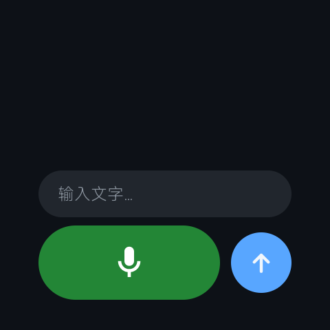
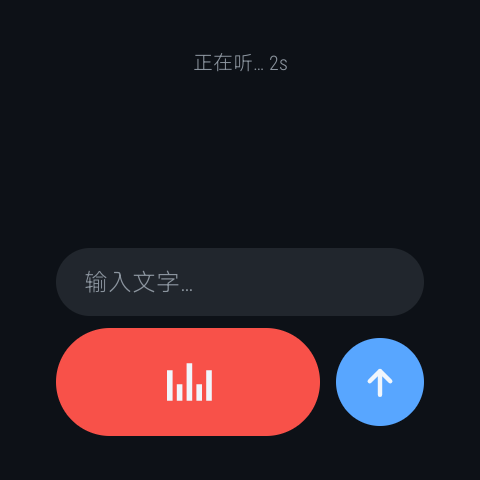

# watch-app — 小米手表 5 对话端 App

这是 `dsh-watch-phone` 的手表端 Android 源码。手表只负责 **录音 / 显示 / 播放**，
语音识别（STT）与朗读（TTS）都在手机侧的插件里完成。

<p align="center">
  
  
</p>

## 它长什么样

- 480×480 圆屏，界面全部按圆形安全区排版（没有文字被切边）。
- 底部是**一颗大号「按住说话」胶囊键**（微信式）：按下变红 + 五根波形跳动 + 顶部显示 `正在听… Ns`，
  松手立刻上传识别。右侧只有一颗小圆形发送键（备用文字输入）。
- 支持长按说话（≥0.6s，最长 20s），松手即发；识别期间转圈，失败提示「没听清，再说一次」。
- 连上 DSH 后自动读回回复（音频由手机端合成 MP3/WAV 下发；手表没有系统 TTS 服务，见下）。

## 依赖

| 项 | 版本 |
| --- | --- |
| JDK | 17（AGP 8.2 不支持 JDK 21，`jlink` 会报 `ModuleTarget is malformed`） |
| Gradle | 8.7（wrapper 已带） |
| Android SDK | compileSdk 34 / buildTools 34.0.0 |
| minSdk | 26 |
| ABI | `armeabi-v7a`、`armeabi`、`arm64-v8a` |

## 构建

```bash
# 只需设置 JAVA_HOME（JDK 17）；SDK 位置写进 local.properties 或 ANDROID_HOME
echo "sdk.dir=/path/to/Android/Sdk" > local.properties

./gradlew assembleRelease          # 产物 app/build/outputs/apk/release/
```

Windows 上如果没装 Gradle，`gradlew.bat` 会用 wrapper 自动下载 8.7。
签名是可选的：

1. 没有 `keystore.properties` → 产出 `app-release-unsigned.apk`（不能直接装）；
2. 想要可安装包，自己生成一个 keystore，然后在工程根目录放 `keystore.properties`（已被 `.gitignore` 忽略）：

```properties
storeFile=../my-release.keystore
storePassword=changeit
keyAlias=watchchat
keyPassword=changeit
```

```bash
keytool -genkeypair -v -keystore my-release.keystore -alias watchchat \
        -keyalg RSA -keysize 2048 -validity 3650
```

## 安装到手表

手表需要先开 **无线调试**（开发者选项 → 无线调试），然后：

```bash
adb connect <watch-ip>:<port>
adb install -r app/build/outputs/apk/release/app-release.apk
adb shell pm grant com.dsh.watchchat android.permission.RECORD_AUDIO
adb shell am start -n com.dsh.watchchat/.MainActivity
```

> 装完改过服务地址的话，`pm clear` 才能清掉旧地址；`pm clear` 同时会清掉麦克风授权，
> 记得补一次 `pm grant … RECORD_AUDIO`。

## 服务地址与发现

APK 里内置几个候选地址（手机热点网关 / 常见局域网网关），启动时会：

1. 先试上次保存的地址（`SharedPreferences` 的 `server`）；
2. 失败则按 `KNOWN_SERVERS` 顺序探 `/health`；
3. 再失败就扫本地 `/24` 网段里的 `38402 / 38401 / 38400`。

想改地址：在 App 里**单击顶部状态文字**（或长按聊天区）会弹出地址输入框。

## 代码结构

| 文件 | 作用 |
| --- | --- |
| `MainActivity.java` | 全部界面与交互：气泡、按住说话、波形动画、TTS 播放调度 |
| `AudioRecorder.java` | `AudioRecord` 16 kHz / mono / PCM16 录音，先写 44 字节占位头，停止时回填 RIFF 长度 |
| `SttUploader.java` | 把 WAV 以 `multipart/form-data`（字段名 `audio`）POST 到 `${server}/stt`，解析 `{"text": …}` |
| `HostTts.java` | POST `${server}/tts` 拿音频，落盘后用 `MediaPlayer` 播放（`USAGE_MEDIA` / `CONTENT_TYPE_SPEECH`） |
| `MyApp.java` | `Application` 子类，给工具类提供 Context |

## 为什么手表端不自己做 TTS

小米手表 5（`M2505W1`，Android 14）**没有 `text-to-speech` 系统服务**：

```
$ adb shell cmd text-to-speech list
cmd: Can't find service: text-to-speech
$ adb shell settings get secure tts_default_synth
null
```

`pm list packages` 里只有 `com.xiaomi.miwear.voiceassist`，不是标准 TTS 引擎。
所以 `TextToSpeech` 一定失败 → 朗读交给手机侧（`POST /tts` 返回 WAV/MP3 直接播放）。

同理 `SpeechRecognizer` 也不可用，语音输入走「录音 → 手机本地 sensevoice 识别」。

## 许可

MIT，见仓库根目录 `LICENSE`。
